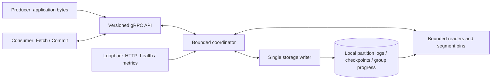

# Kaflow

Kaflow is a lightweight, single-node durable partitioned event-log broker with a custom
gRPC API. Producers send opaque bytes; consumer groups Fetch records and explicitly Commit
the next offset. Topics have fixed partition counts. It supports deterministic routing,
durable Append acknowledgements, conservative recovery, leased membership and generation
fencing, asynchronous long polling, independent group progress, opt-in retention and quotas.



This is not Kafka wire/client compatible. There is no replication, automatic failover,
transaction protocol or exactly-once processing. An ambiguous Append retry can duplicate a
record; Commit does not prove application processing. The supplied clients and listeners use
plaintext without authentication. Keep this quickstart on a trusted local machine. Passing
checks are not a production-readiness or physical power-loss guarantee.

## Native quickstart

Use JDK 17, Python 3 and the checked-in Gradle wrapper. Run from the repository root:

```sh
./gradlew clean :app:classes :app:testClasses :app:bootJar --no-daemon
./gradlew :clients:installDist :clients:healthProbeJar --no-daemon
./gradlew :app:test :clients:test --rerun-tasks --no-daemon
java -Xms64m -Xmx512m -jar app/build/libs/app.jar \
  --kaflow.durable.enabled=true \
  --kaflow.durable.directory="$PWD/local-data" \
  '--kaflow.durable.topics[0].name=orders' \
  '--kaflow.durable.topics[0].partitions=1' \
  '--kaflow.durable.topics[1].name=json-orders' \
  '--kaflow.durable.topics[1].partitions=1'
```

The selected directory must be dedicated to this broker; use a fresh path for the demo.
Recovery and idempotent startup provisioning finish before readiness. A mismatched partition
count fails startup. There is no volatile fallback. In another terminal:

```sh
curl --fail http://127.0.0.1:8080/actuator/health/readiness
clients/build/install/kaflow-client/bin/kaflow-client demo
clients/build/install/kaflow-client/bin/kaflow-client produce --topic json-orders --key-hex ''
clients/build/install/kaflow-client/bin/kaflow-client consume --topic json-orders --group json-example
curl --fail http://127.0.0.1:8080/actuator/metrics/kaflow.rpc.outcomes
```

On the fresh `orders` topic, demo reports `committedA: 2`, `committedB: 1` and
`replayUnchanged: true`. Stop the foreground broker with Ctrl-C, wait for its exit, then run
the identical startup and demo commands. They resume at A=2/B=1 and finish at A=4/B=2.
The JSON example logs receipt and processed-offset metadata, not payloads or session tokens.
See [examples](docs/examples.md) for deadlines, replay, rebalance and out-of-range handling.

## Docker workflow

The Dockerfile and Compose workflow passed the complete Linux CI container acceptance gate,
including non-root ownership, persistent replacement and parked-request shutdown. See the
[exact-revision evidence](docs/baseline/kf-009.md#final-linux-container-acceptance--2026-11-08).
A local Docker engine and Compose are still required to run these commands.

```sh
docker compose up --build -d
curl --fail http://127.0.0.1:8080/actuator/health/readiness
clients/build/install/kaflow-client/bin/kaflow-client demo
docker compose stop
docker compose rm -f
docker compose up -d
clients/build/install/kaflow-client/bin/kaflow-client demo
docker compose down
```

The named volume survives these commands. Do not add `--volumes` to ordinary shutdown.
Container listeners bind `0.0.0.0`; Compose publishes only on host `127.0.0.1`. The runtime
uses UID/GID 10001, a dedicated volume, direct JVM signal delivery and a 15s stop grace for
its 10s shutdown budget. See [operations](docs/operations.md) for ownership and image policy.

## Operator and validation references

- [Configuration](docs/configuration.md): defaults, bounds, precedence and endpoint surfaces.
- [Operations](docs/operations.md): health/metrics, retention, quotas, recovery, backup and shutdown.
- [V1 schema](app/src/main/proto/kaflow/v1/broker.proto) and [contracts](docs/design/kf-009-operable-release.md).
- [Benchmarks](docs/benchmarks.md): reproducible workloads, measurement rules and actual results.
- [Development checks](docs/development.md), [KF-009 evidence](docs/baseline/kf-009.md), [ticket board](todo.md).

The default launch without durable opt-in remains the isolated, volatile prototype with its
legacy REST/gRPC surface; V1 is absent there. Its [historical README](docs/history/prototype-readme.md)
and design/blog material are separate from the durable release. No remote topic/reset service
is added. Authentication/TLS deployment, replication and other distributed features remain deferred.
