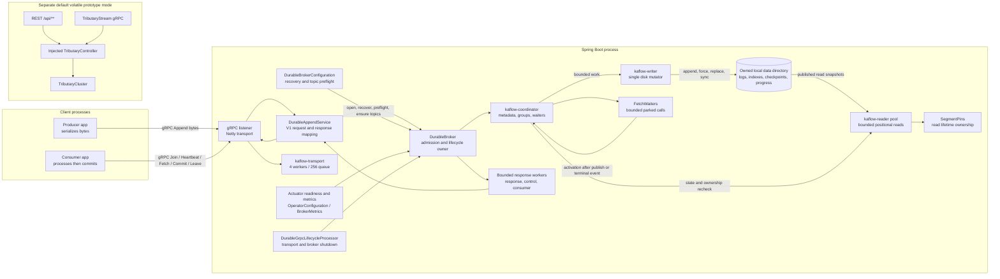
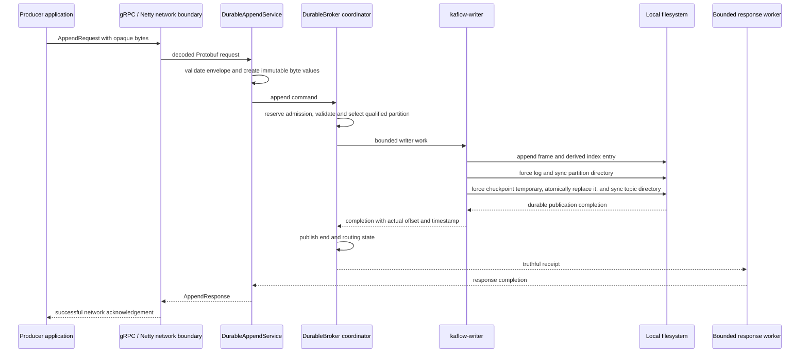
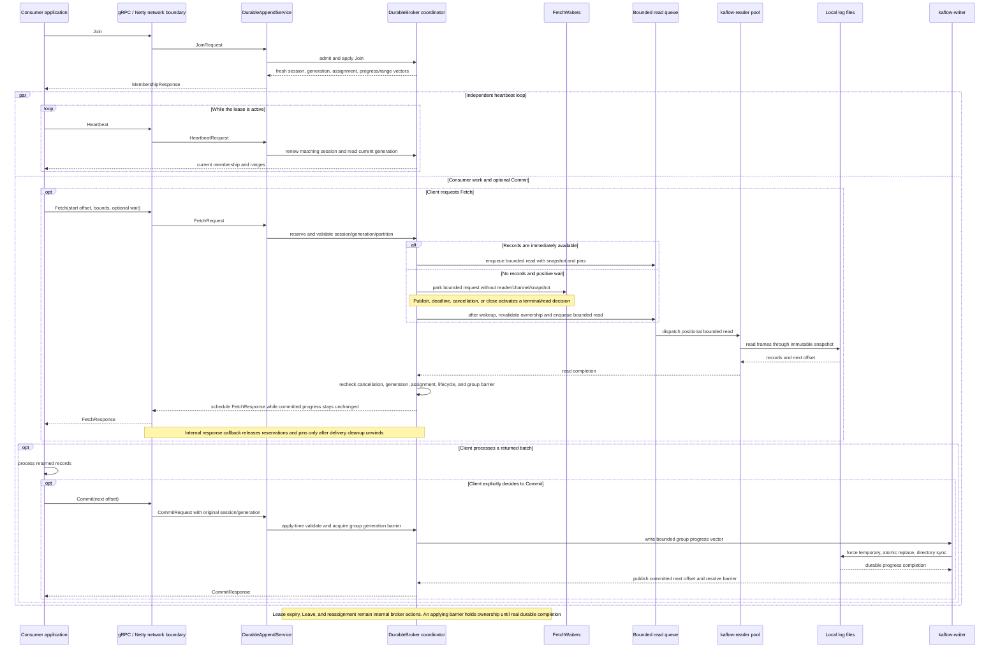

# Kaflow architecture

Kaflow is a single-node durable partitioned event log. The durable runtime uses Java 17,
Spring Boot for composition and operations, and the versioned `kaflow.v1` unary gRPC API.
The default `kaflow.durable.enabled=false` runtime remains the older volatile Tributary
prototype. The durable runtime is selected explicitly and does not fall back to prototype
state if opening or recovering its store fails.

Producers choose their application serialization and send its bytes. For example:

`Order(orderId="o-42", quantity=2)` → JSON encoded as UTF-8 bytes → Protobuf `Append`
envelope with `bytes payload` → immutable broker record containing those same bytes →
future `Fetch` envelope → application JSON deserialization.

Protobuf defines the transport envelope; it does not define the bytes' format. Kaflow does
not parse, normalize, transcode, or infer payload formats. Empty payloads and arbitrary
binary data, including invalid UTF-8, are valid. Producer and consumer applications agree
on serialization out of band. Headers, content-type fields, and schema management are not
part of V1. Current V1 Fetch returns the original bytes. Disk storage wraps those same bytes
in a versioned binary frame with lengths, metadata, and integrity checks; KF-010 does not
change that existing storage or wire behavior.

Kaflow is not Kafka wire/client compatible. It does not provide replication, failover,
transactions, producer deduplication, exactly-once processing, or a production capacity
claim. An Append timeout or lost response can follow durable publication; retry may create
a duplicate. Commit records a broker offset and does not prove application processing.

## System and component ownership

The durable application path is composed by `TributaryApplication`,
`DurableBrokerConfiguration`, and `DurableGrpcLifecycleProcessor`. Recovery, full-list
startup topic preflight, and idempotent topic provisioning complete before the durable V1
listener starts. `DurableAppendService` maps Protobuf messages to immutable broker values;
it contains no log-format decisions. `DurableBroker` owns admission, metadata coordination,
groups, offsets, fetch waiters, read reservations, lifecycle, and published boundaries.
The coordinator thread performs no disk I/O or network response callbacks. One writer
serializes all durable mutations. Read workers use bounded snapshots and positional file
access. Response delivery has separate bounded executors for ordinary calls, group controls,
and consumer work. The four-worker transport executor has a 256-entry queue. Their names and
limits are set in `DurableBroker` and `DurableBrokerConfiguration`.

`OperatorConfiguration.BrokerReadiness` combines application startup, the gRPC listener,
and durable broker readiness. `BrokerMetrics` records a fixed set of method/status labels
and bounded broker snapshots. HTTP exposes Actuator health and metrics; it is not a storage
administration API. Standard gRPC health/reflection come from the gRPC starter and do not
replace broker-aware HTTP readiness.

The prototype cluster and its REST/streaming gRPC adapters are conditional on durable mode
being false or absent. REST and prototype gRPC share one injected controller and one
instance-owned cluster. `InMemoryBroker` is a separate in-process V1 contract core; the
application does not register it as a network service. The durable broker is a separate
runtime and data namespace. No prototype/V1 dual write occurs. Prototype typed messages,
`Any` conversion, and custom legacy behavior do not define the opaque-byte V1 contract.

## Durable Append publication

The success response is created only after the partition data and publication checkpoint
have been forced and the required directories synchronized, then the coordinator publishes
the completed boundary. Offsets start at zero and are contiguous per qualified partition.
Explicit partition selection takes precedence; otherwise a present key routes by the first
eight SHA-256 bytes, unsigned and big-endian, modulo partition count; absent keys use
per-topic round-robin. Only a successful unkeyed append advances that counter.

Request and transport buffers exist before broker admission. The logical call/byte limits
bound broker admission and retained store bytes, not caller allocations, gRPC transport
buffers, the OS page cache, or total JVM heap. The gRPC adapter copies incoming Protobuf
bytes when building immutable values; that input copy is outside the broker admission
budget. A watchdog timeout does not cancel a potentially executing filesystem call or
release its directory ownership. The broker degrades, retains the writer and resolves a
late completion exactly once. If the write became durable but the response was not observed,
the client outcome is ambiguous and a retry may duplicate the record.

Supporting implementation: `DurableAppendService`, `DurableBroker`, `PartitionLog`,
`DurableMetadata`, `Persistence`, `DirectoryLease`, and `DurableGrpcLifecycle` under
`app/src/main/java/tributary/stream`, `kaflow/storage`, and `tributary/config`.

## Consumer ownership, Fetch, and Commit

Join allocates a new leased session; group definitions and progress are durable, while
sessions and assignments are process-local. Heartbeat is a separate control operation and
clients may run it independently while a Fetch or application processing is in progress.
Generation and qualified partition ownership are checked before work and again at the
relevant apply/delivery boundary. Fetch never commits. Applications process records before
explicitly committing the next offset; a crash between those steps can repeat application
work. Commit does not atomically include an external application database.

Immediate Fetch proceeds directly to bounded read admission. A positive-wait Fetch with no
available records is registered in the bounded waiter registry and holds request metadata
only: it does not occupy a read worker, channel, snapshot, or segment pin. Publication,
deadline, cancellation, or lifecycle closure wakes it. After wakeup the broker revalidates
membership and group barriers before a snapshot/read. Reservations and pins remain until
actual read and response-delivery cleanup unwinds, including after client cancellation.

An applying commit pins its entire consumer group behind a generation barrier. Reassignment,
expiry, Leave, or other work that could change ownership waits for the real durable completion;
an uncertain write keeps the barrier and directory ownership until recovery. Other groups
remain independent. Heartbeat remains separately admitted and does not clear degraded storage
readiness. Client-side observed membership cannot make application effects atomic with later
fencing, so a fenced or ambiguous Commit can imply duplicate processing.

Supporting implementation: `DurableAppendService`, `DurableBroker`, `FetchWaiters`,
`GroupMembership`, `ReadSnapshot`, `SegmentPins`, `ConsumerProgress`, and
`DurableGrpcLifecycle`.

## Wire surface and durable formats

The source of truth for field numbers and optional-field presence is
`app/src/main/proto/kaflow/v1/broker.proto`. The unary `kaflow.v1.Broker` methods are
Append, Join, Heartbeat, Leave, Fetch, and Commit. Append carries one record. Fetch is
bounded and returns records with qualified identity, offsets, timestamps, opaque payload,
next offset and published end. Join/Heartbeat return leased identity, generation, assignment,
committed next offsets, retained starts, and published ends. Commit is an explicit durable
next-offset update. No producer sequencing/idempotence token, transaction, batch append,
public reset, or public topic-creation/reset API is present.

| Stored form | Current version | Purpose and recovery authority |
| --- | --- | --- |
| Partition segment header and record frame (`KFLG`) | V1 | Big-endian identity and lengths, contiguous offset, timestamp, optional-key presence, exact key/payload bytes, CRC32C. The durable checkpoint decides which prefix is published. |
| Sparse segment index (`KFIX`) | V1 | Derived offset-to-position entries with CRC32C. Rebuilt from validated authoritative log bytes when missing or stale. |
| Catalog (`KFCA`) | V1–V4 | V1 topics; V2 durable group definitions; V3 required group progress; V4 retention authority and checkpoint requirement flag. Ordered topic/group slots avoid using application names as paths. |
| Partition checkpoint (`KFCP`) | V1–V2 | Durable next offset, segment base/end, byte boundary and routing count; V2 adds retained start. Checkpoints are authoritative for publication and retained history. |
| Group progress (`KFCO`) | V1 | One bounded vector per durable group, holding next offsets and a revision. Catalog V3/V4 determines when these files are required. |
| Root ownership marker | `KAFLOW-DURABLE-1` | Exact marker stored on the permanently retained root lock inode. Prevents a missing catalog from being mistaken for an uninitialized store. |

All versioned binary metadata/log frames are bounded before allocation and use CRC32C for
accidental-corruption detection; checksums do not authenticate or prevent a valid older
metadata image being maliciously restored. Unknown names, unsupported authoritative versions,
missing published bytes or corrupt retained data fail closed. Recovery may clean only
recognized unpublished artifacts after validating authority. Sparse indexes are derived;
published logs and required metadata are not silently discarded.

| Compatibility boundary | Behavior |
| --- | --- |
| Catalog V1/V2 | Readable without silently rewriting at open; V2 contains group definitions. First effective Commit/reset publishes progress authority as V3. |
| Catalog V3 | Requires V1 progress files for every existing group. Older KF-005 binaries reject this catalog. |
| Catalog V4 / checkpoint V2 | Retention authority; checkpoint V2 carries retained start. Older binaries reject the newer catalog/checkpoint. |
| Standalone KF-003 partition directories | No migration into the durable store. |
| Downgrade after progress/retention authority begins | Unsupported. Disabling retention does not restore expired data or make old binaries safe. |

Root and partition locks are exclusive. Keep the complete store together and never remove
lock inodes, root markers, checkpoints, or progress files as a repair shortcut. Linux local
storage honoring file force, same-directory atomic replacement, directory synchronization,
and device flush ordering is the durability reference. macOS/APFS is used for development;
process-kill and restart tests are not physical power-loss tests. Network filesystems,
malicious external file changes, storage devices that misreport flush completion, and host
or disk loss are not covered by this single-node design.
